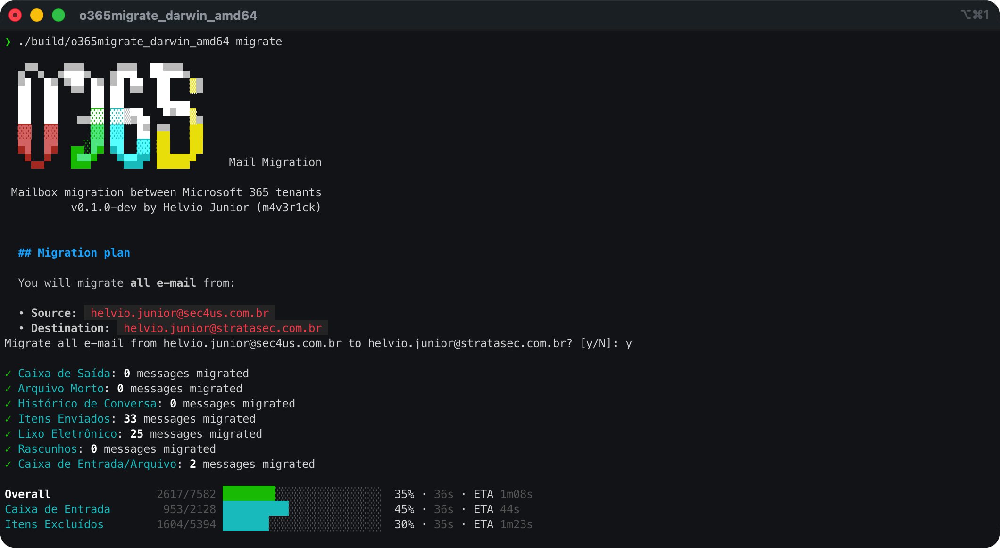

# O365 Mail Migration

Command-line tool (`o365migrate`) to **migrate an entire mailbox between two
different Microsoft 365 tenants** using the Microsoft Graph API — including
Inbox, Archive, Deleted Items, Junk, Sent, Drafts and all custom folders — while
preserving the original metadata (received/sent dates, read state, follow-up
flags and categories).

Built in the same style as [enumdns](https://github.com/helviojunior/enumdns)
(Go + cobra + charmbracelet/log + gorm/sqlite). BSD-2-Clause.



> ⚠️ **Authorized use only.** Migrate mailboxes you own or are explicitly
> authorized to move. You interactively sign in as the source and destination
> users, so the tool only ever touches those two mailboxes.

## How it works

1. `auth-source` — interactive **device-code** login to the tenant you migrate
   **from**. The token (with refresh token) is cached locally.
2. `auth-destination` — same, for the tenant you migrate **to**.
3. `migrate` — after a confirmation, it walks every source folder, recreates the
   folder tree in the destination, and copies each message:
   - `GET /me/messages/{id}/$value` exports the **full original MIME** (headers,
     body, attachments, inline images) — this is what carries the original
     `Date:` / `Received:` headers.
   - `POST /me/mailFolders/{dest}/messages` (Content-Type `text/plain`, base64
     body) re-imports that MIME into the destination.
   - `PATCH /me/messages/{newId}` restores `isRead`, the follow-up flag and
     categories — and, with `--fix-dates` (default on), also forces the original
     received/sent timestamps via MAPI extended properties
     (`SystemTime 0x0E06` / `SystemTime 0x0039`) in the same request.
4. **Final step** (`--migrate-settings`, default on) — migrate mailbox settings:
   - **Inbox rules** (`/me/mailFolders/inbox/messageRules`), with any
     move/copy-to-folder actions remapped to the destination folders.
   - **Automatic replies / out-of-office** (`/me/mailboxSettings`).
5. **Final step** (`--migrate-calendars`, default on) — migrate **calendars and
   events**: each source calendar is matched by name (or created) in the
   destination — the default calendar maps to the destination's default — and its
   events are copied (`POST /me/calendars/{id}/events`). Single events and
   recurring series (the series master, with its recurrence) are copied;
   individual occurrences are regenerated from the series. The copy is resumable
   and deduped via local state, so re-runs do not duplicate.
   - **No invitation emails are sent.** Microsoft Graph always emails invitations
     when an event is created with attendees (it "can't be configured"), so
     events are copied as appointments **without** attendees. The original
     attendee list is appended to the event body for reference.

> Settings migration needs `MailboxSettings.ReadWrite`; calendar migration needs
> `Calendars.Read` (source) / `Calendars.ReadWrite` (destination). These are in
> the defaults — if you authenticated before they were added, re-run
> `auth-source` / `auth-destination` so the new scopes are consented.

### Running several migrations in parallel

By default, tokens and state live in `~/.o365migrate`. Pass **`--local`** (on
every command) to use `./.o365migrate` under the current directory instead, so
you can migrate several users at once from separate folders:

```bash
mkdir alice && cd alice
o365migrate --local auth-source
o365migrate --local auth-destination
o365migrate --local migrate
```

### Date preservation

The received/sent dates are preserved in two complementary ways:

1. **MIME headers** — the re-imported MIME keeps its original `Date:`/`Received:`
   headers, which Graph normally uses to set `sentDateTime`/`receivedDateTime`.
2. **MAPI extended properties** (`--fix-dates`, default on) — the same PATCH that
   restores read state also sets `PR_MESSAGE_DELIVERY_TIME` (0x0E06) and
   `PR_CLIENT_SUBMIT_TIME` (0x0039). No extra request.

Writing those properties on an already-imported message is **best-effort**: some
tenants may not reflect them in `receivedDateTime`. Run with `--verify-dates` on
a test mailbox — it re-reads each copy and reports any drift in the summary.

State is tracked in a SQLite DB (`~/.o365migrate/state.db`), so a run is
**resumable and idempotent**: already-migrated messages are skipped unless you
pass `--force`. In addition, before copying a folder the tool pre-scans the
**destination** for messages already there (by `internetMessageId`) and skips
them — so re-running (or resuming an interrupted run) does **not** create
duplicates, even if the local state DB is lost. Disable with
`--check-destination=false` for maximum speed on a known-empty destination.

Imported messages are marked **read and not drafts** (MIME import would
otherwise leave them as unread drafts) via the `PR_MESSAGE_FLAGS` MAPI property;
items from the source Drafts folder stay drafts. If the destination tenant
rejects these metadata PATCHes, the count is shown as "Metadata PATCH failures"
in the summary.

## Install / build

```bash
make local          # builds ./build/o365migrate_<os>_<arch>
# or
go build -o o365migrate .
```

## Usage

```bash
# 1. Sign in to both tenants (opens a device-code prompt: URL + code)
o365migrate auth-source
o365migrate auth-destination

# 2. Preview what will be migrated
o365migrate migrate --dry-run

# 3. Run it
o365migrate migrate
# non-interactive:
o365migrate migrate --yes --threads 4

# Only some folders (prefix match on the folder path):
o365migrate migrate --include-folder Inbox --include-folder Archive
o365migrate migrate --exclude-folder "Junk Email"
```

To migrate several users, repeat the three steps per user (one mailbox per run).

### Cleaning up duplicates

If an older run (before destination de-duplication) left duplicates, remove them
with `dedup` — it deletes messages that repeat **within the same folder** (same
`internetMessageId`), keeping one copy:

```bash
o365migrate dedup --dry-run          # report duplicates per folder
o365migrate dedup                    # delete them (asks to confirm)
o365migrate dedup --account source   # clean the source mailbox instead
```

### Progress

On an interactive terminal, migration runs **docker-compose style**: an area is
pinned to the bottom of the screen whose first line is an **`Overall`** bar
(whole-mailbox progress — total messages, percentage, elapsed and ETA, updated
continuously), followed by one live bar per in-flight folder (count, percentage,
elapsed and **ETA**). When a folder finishes, a permanent line is printed above
the area and the remaining bars move up and continue:

- `✓ <Folder>: N messages migrated` when everything copied, or
- `✗ <Folder>: N migrated, F failed` when some messages failed.

The overall totals (including the total failure count) are shown in the summary
at the end; full per-message error details are in the state DB. How many folders run at once is
`--folder-concurrency` (default 4); the total number of concurrent message
copies across all folders is capped by `--threads` (default 4). In this mode
per-message errors are not printed live (they would corrupt the area) — they are
recorded in the state DB and counted in the final summary.
(Bars are coloured with [`pterm`](https://github.com/pterm/pterm).)

When the output is **not** a TTY (piped, redirected or run under CI/cron), it
instead logs a plain `[status] …` snapshot every 60 seconds. Both are suppressed
with `--quiet`.

### Authentication options

By default it uses **Thunderbird's generic public client**
(`9e5f94bc-e8a4-4e73-b8be-63364c29d753`) against the `common` tenant. Everything
is overridable:

```bash
o365migrate auth-source \
  --client-id 9e5f94bc-e8a4-4e73-b8be-63364c29d753 \
  --tenant common \
  --authority https://login.microsoftonline.com \
  --scope https://graph.microsoft.com/Mail.ReadWrite \
  --scope https://graph.microsoft.com/MailboxSettings.Read \
  --scope https://graph.microsoft.com/User.Read
```

Default delegated scopes: `Mail.ReadWrite`, `MailboxSettings.Read`, `User.Read`
(Microsoft **Graph**). Auth failures are parsed and shown with the AADSTS code
plus a hint.

> **Important — client vs. API:** this tool talks to the Microsoft **Graph**
> API, so it needs *Graph* scopes. The Thunderbird client is normally registered
> for *IMAP/POP/SMTP* (`outlook.office.com`) scopes, so requesting Graph scopes
> with it can fail with a consent error (e.g. `AADSTS65001`) in some tenants. If
> that happens, register your own multi-tenant app in Entra ID (public client,
> device-code flow enabled, Graph Mail delegated permissions) and pass it via
> `--client-id`.

## Limitations

- **Received-date fidelity** relies on Graph honouring the `Received:`/`Date:`
  headers of the re-imported MIME, reinforced by the `--fix-dates` extended
  properties. Both are best-effort on arbitrary tenants — validate with
  `--verify-dates` on a test mailbox first (it reports any drift).
- **Recoverable Items (dumpster)** are not accessible via delegated Graph. The
  *Deleted Items* folder is migrated; permanently purged items are not.
- **Very large messages** may exceed the import endpoint limit; they are logged
  and recorded as `failed`, and the run continues.
- Scope is **e-mail only** (no calendar/contacts) and **one mailbox per run**.

## Files & state

| Path | Purpose |
|------|---------|
| `~/.o365migrate/source.json` | Source token cache (OAuth tokens — keep private) |
| `~/.o365migrate/destination.json` | Destination token cache |
| `~/.o365migrate/state.db` | Migration progress (folders + per-message status) |

## Development

```bash
make hooks   # install the gofmt pre-commit hook
make fmt     # gofmt -s -w .
go test ./...
```
